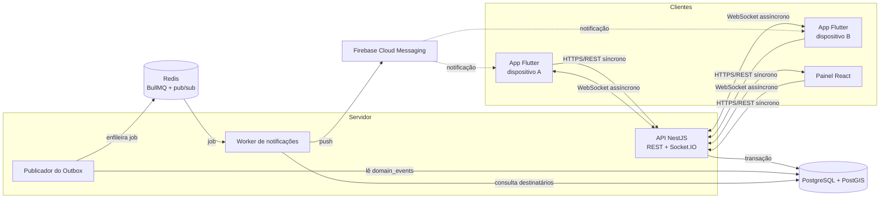
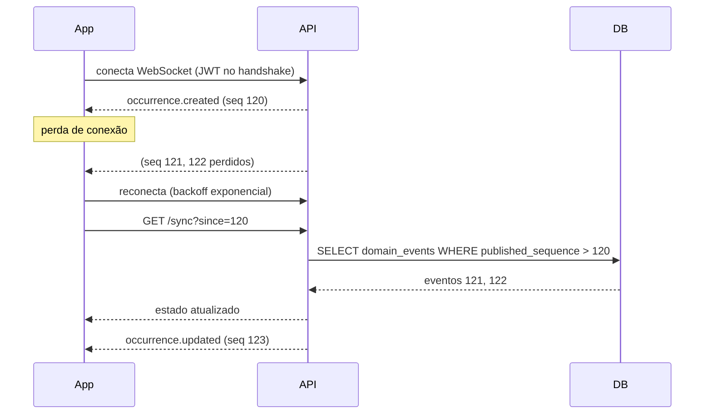

# 1. Arquitetura técnica — AlertaCidade 2.0

## 1.1 Visão geral

O AlertaCidade é um sistema distribuído composto por **cinco processos independentes** que se comunicam por rede:

| Processo | Tecnologia | Responsabilidade |
|---|---|---|
| App mobile | Flutter 3 / Dart, Riverpod, GoRouter, Dio, flutter_map, geolocator | Cidadão: mapa, registro, confirmação, alertas |
| Painel admin | React + TypeScript + Vite | Moderação, dashboard, relatórios, auditoria, usuários |
| API | NestJS 11 / TypeScript 5.9, Prisma 6, Socket.IO | Regras de negócio, autenticação, persistência, tempo real |
| Worker de notificações | Node.js + BullMQ | Consome eventos, calcula destinatários, envia FCM |
| Infraestrutura | PostgreSQL 17 + PostGIS 3.5, Redis 7.4 | Persistência compartilhada, fila, pub/sub |



## 1.2 Como cada requisito de Sistemas Distribuídos é atendido

| # | Requisito da APS | Mecanismo no AlertaCidade | Fase |
|---|---|---|---|
| 1 | Comunicação cliente–servidor | REST/JSON sobre HTTP com JWT; contrato documentado no Swagger | 2 |
| 2 | Compartilhamento de informações | Banco único PostgreSQL; todos os clientes leem o mesmo estado | 1–2 |
| 3 | Processamento distribuído | API e worker são processos separados; o envio de push não bloqueia a requisição | 4 |
| 4 | Comunicação síncrona e assíncrona | Síncrona: REST. Assíncrona: WebSocket (servidor→cliente) e fila BullMQ (API→worker) | 2, 4 |
| 5 | Sincronização de informações | Cursor de entrega `domain_events.published_sequence`: ao reconectar (ou ao detectar lacuna) o cliente pede `GET /sync?since=<cursor>` | 4 |
| 6 | Concorrência e integridade | Transações; `UNIQUE(occurrence_id,user_id)` + `INSERT … ON CONFLICT`; controle otimista via `version` na moderação | 1–5 |
| 7 | Tolerância a falhas | Outbox transacional; retries com backoff no BullMQ; AOF no Redis; health checks (Redis fora → `degraded`); app com **rascunho persistente e reenvio idempotente** (`clientRequestId`: sem rede, o registro fica salvo no aparelho e o reenvio manual não duplica; fotos retomam de onde pararam) — não há envio automático em segundo plano | 1, 4 |
| 8 | Processamento de eventos | Eventos `occurrence.*` gravados no outbox e distribuídos para WebSocket e worker | 4 |
| 9 | Persistência compartilhada | PostgreSQL/PostGIS como fonte da verdade; Redis apenas como transporte | 1 |
| 10 | Recuperação de conexões | Socket.IO com reconexão exponencial + ressincronização pelo estado persistido | 4 |

**Fase 7 (News Intelligence)** reforça os mesmos requisitos com um terceiro processo, o `news-worker`: filas separadas
para coleta, análise e manutenção (BullMQ, com repetição e DLQ), agendamento único no Redis mesmo com várias
instâncias, agrupamento sob *advisory lock* e trava da linha do evento (`FOR UPDATE`) contra condições de corrida, e a
decisão de publicar + o evento `news.alert.*` gravados na **mesma transação** (outbox). Eventos de moderação
(`news.review.*`) têm **audiência restrita**: só as salas de MODERATOR/ADMIN no Socket.IO, e o `/sync` os omite para
cidadãos. Detalhes em [07-news-intelligence.md](07-news-intelligence.md).

## 1.3 Padrões distribuídos adotados

### Transactional Outbox (evitar perda de eventos)
Gravar no banco e publicar no Redis são duas operações em sistemas diferentes; se a API cair entre elas, o evento se perde. Por isso **a alteração de negócio e o evento são gravados na mesma transação** (`domain_events`). Um publicador lê os eventos com `published_at IS NULL` (usando `FOR UPDATE SKIP LOCKED`, o que permite várias instâncias), envia ao BullMQ/Socket.IO e marca como publicados. Resultado: entrega **pelo menos uma vez**.

### Idempotência (evitar duplicidade)
Como a entrega é "pelo menos uma vez", todo consumidor precisa tolerar repetições:

| Ponto | Garantia |
|---|---|
| Criação de ocorrência | App envia `clientRequestId` (UUID); `UNIQUE(created_by_id, client_request_id)` — reenvio devolve o registro existente |
| Confirmar/contestar | `UNIQUE(occurrence_id, user_id)` + upsert — uma manifestação ativa por usuário |
| Job do worker | `jobId = eventId` no BullMQ + tabela `processed_messages(consumer, message_id)` |
| Notificação | `UNIQUE(user_id, source_event_id)` — o mesmo evento nunca notifica a mesma pessoa duas vezes |
| Cliente WebSocket | Descarta eventos com `sequence` ≤ último processado; detecta lacuna e ressincroniza |

### Sincronização após desconexão

O app **nunca depende apenas do evento em memória**: o estado persistido é a fonte da verdade.

> **Cursor de entrega (implementado na Fase 4).** O número enviado ao cliente é `published_sequence`, atribuído pelo publicador na ordem em que publica (sob *advisory lock*), e não o `sequence` gerado no INSERT: transações confirmam fora de ordem, e usar o `sequence` faria um evento confirmado depois de outro ser descartado pelo cliente e ignorado pelo `/sync`. Ver `docs/testing/fase-4.md`.

## 1.4 Decisão: ORM — Prisma 6 (ADR-001)

**Contexto.** A especificação pede um único ORM com bom suporte a migrations e a PostGIS.

**Opções avaliadas.**

| Critério | Prisma 6 | TypeORM |
|---|---|---|
| Migrations | Geradas a partir do schema declarativo, SQL editável, verificação de drift (`migrate diff`) | Geração por diff de entidades, historicamente sujeita a migrations espúrias |
| Tipagem | Client 100% tipado gerado do schema | Decorators, tipagem parcial em query builder |
| PostGIS | `Unsupported("geography")` + índice GIST no schema; consultas espaciais via `$queryRaw` parametrizado | Tipo `geography` nativo nas entidades |
| SQL seguro | Tagged templates parametrizam automaticamente | Depende do uso correto do query builder |

**Decisão.** Prisma. O suporte espacial "nativo" do TypeORM cobre só o mapeamento da coluna; as consultas por raio (`ST_DWithin`, `ST_Distance`) seriam SQL de qualquer forma. O Prisma oferece migrations mais previsíveis e tipagem superior. Para manter a coluna geográfica consistente, ela é **derivada por trigger** de `latitude/longitude` — a aplicação nunca a escreve, e regras não expressáveis no Prisma (triggers, CHECKs) ficam na migration SQL. O script `npm run db:check-drift` garante que schema e migrations não divergem.

## 1.5 Decisão: versões (ADR-002)

Versões verificadas no registro npm em 23/11/2026:

| Pacote | `latest` no npm | Adotada | Motivo |
|---|---|---|---|
| prisma | 8.0.0-rc.35 | **6.19.3** | `latest` aponta para um *release candidate*; Prisma 7 altera configuração e exige driver adapters |
| typescript | 7.0.2 | **5.9.3** | TS 7 (compilador nativo) ainda sem suporte pleno em ts-jest e ferramentas do Nest |
| @nestjs/* | 12.x | **11.2.x** | Linha madura e compatível com TS 5.9, Swagger 11 e Jest 29 |
| jest / ts-jest | 30 / 29 | **29.7 / 29.4** | ts-jest 29 é homologado com Jest 29 |
| Node.js | — | **22 LTS** | Instalado na máquina (v22.19) e suportado por todas as dependências |
| PostgreSQL/PostGIS | — | **17 / 3.5** (imagem `postgis/postgis:17-3.5`) | Versões estáveis com imagem oficial |
| Redis | — | **7.4** | Requisito do BullMQ ≥ 6.2; AOF habilitado |

Todas as dependências são fixadas em versão exata (sem `^`) para builds reprodutíveis.

## 1.6 Módulos da API (NestJS)

```
apps/api/src/
├── config/          validação de ambiente (Fase 1)
├── prisma/          PrismaService global (Fase 1)
├── health/          GET /api/v1/health — banco + PostGIS (Fase 1)
├── auth/            cadastro, login, refresh rotativo, recuperação de senha (Fase 2)
├── users/           perfil, LGPD: exportação e exclusão de dados (Fase 2)
├── occurrences/     CRUD, consulta por raio, filtros (Fase 2)
├── photos/          upload validado (tipo real por assinatura, tamanho, EXIF removido) (Fase 2)
├── confirmations/   confirmar/contestar com upsert transacional (Fase 2)
├── events/          outbox + publicador (Fase 4)
├── realtime/        gateway Socket.IO autenticado, rooms por perfil (Fase 4)
├── notifications/   preferências, caixa de entrada, device tokens (Fase 4)
├── moderation/      transições de status com controle otimista (Fase 5)
├── reports/         agregações SQL + exportação CSV (Fase 5)
└── audit/           interceptor de auditoria + consulta (Fase 5)
```

Regra de dependência: módulos de domínio não importam uns aos outros diretamente quando a interação pode ser um evento — `occurrences` publica `occurrence.created`; `notifications` e `realtime` reagem. Isso evita dependências circulares.

## 1.7 Segurança (resumo; detalhado na Fase 6)

- Senhas com **Argon2id**; JWT de acesso de 15 min + refresh token rotativo armazenado apenas como hash, com detecção de reuso (revoga a família).
- RBAC por decorator `@Roles()` + guard; autorização por recurso (cidadão só lê os próprios registros privados).
- Validação de entrada com `class-validator` (whitelist + forbidNonWhitelisted); SQL apenas parametrizado.
- Rate limiting (`@nestjs/throttler`), Helmet, CORS por lista de origens (proibido `*` em produção — validado na inicialização).
- Upload: limite de 10 MB (também em CHECK no banco), tipos JPEG/PNG/WebP verificados pela assinatura do arquivo, nome gerado pelo servidor, remoção de metadados EXIF (que contêm GPS).
- LGPD: localização só com consentimento explícito; área de interesse escolhida pelo usuário em vez de rastreamento contínuo; notificações guardam a distância calculada, não a posição do usuário; exclusão de conta anonimiza dados pessoais.
- Aviso permanente: o AlertaCidade **não é serviço oficial de emergência** (Defesa Civil 199, Bombeiros 193).
