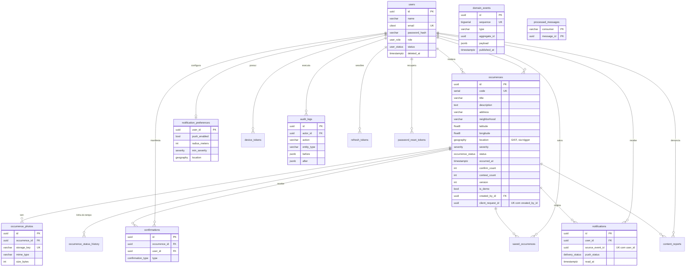

# 4. Modelo de dados

Fonte: [`apps/api/prisma/schema.prisma`](../../apps/api/prisma/schema.prisma) e a migration
[`20261123000000_init`](../../apps/api/prisma/migrations/20261123000000_init/migration.sql).

## 4.1 Diagrama entidade-relacionamento



## 4.2 Tabelas

| Tabela | Finalidade | Regras de integridade principais |
|---|---|---|
| `users` | Contas e perfis | e-mail `citext` único (case-insensitive), CHECK de formato; exclusão lógica |
| `refresh_tokens` | Sessões (só hash) | família para detectar reuso |
| `password_reset_tokens` | Códigos de recuperação (só hash) | ≤ 10 tentativas |
| `occurrences` | Relatos de alagamento | lat/lng em faixa válida; `location` NOT NULL via CHECK; `RESOLVED ⇒ resolved_at`; idempotência por `(created_by_id, client_request_id)` |
| `occurrence_photos` | Evidências | MIME ∈ {jpeg, png, webp}; ≤ 10 MB; até 5 por ocorrência |
| `confirmations` | Confirmar/contestar | `UNIQUE(occurrence_id, user_id)` |
| `occurrence_status_history` | Linha do tempo / moderação | — |
| `saved_occurrences` | Ocorrências salvas | PK composta |
| `content_reports` | Denúncias | uma por usuário por ocorrência |
| `notification_preferences` | Raio, gravidade mínima, área de interesse | raio 100 m–50 km; lat/lng ambos ou nenhum |
| `device_tokens` | Tokens FCM | token único |
| `notifications` | Caixa de alertas | `UNIQUE(user_id, source_event_id)` |
| `domain_events` | Outbox + cursor de sincronização | `sequence` monotônico |
| `processed_messages` | Idempotência de consumidores | PK `(consumer, message_id)` |
| `audit_logs` | Auditoria (antes/depois em JSONB) | — |

## 4.3 Consulta geográfica de referência

```sql
-- Ocorrências ativas num raio de :raio metros, da mais próxima para a mais distante.
SELECT id, title, severity, status,
       ST_Distance(location, ST_SetSRID(ST_MakePoint(:lng, :lat), 4326)::geography) AS distance_m
FROM occurrences
WHERE deleted_at IS NULL
  AND status IN ('PENDING', 'UNDER_REVIEW', 'VALIDATED')
  AND ST_DWithin(location, ST_SetSRID(ST_MakePoint(:lng, :lat), 4326)::geography, :raio)
ORDER BY distance_m
LIMIT 50;
```
`ST_DWithin` sobre `geography` usa o índice GIST `occurrences_location_idx` (comprovado em teste com `EXPLAIN`) e calcula distâncias em metros sobre o elipsoide.

## 4.4 Datas e fuso horário
Todas as colunas são `timestamptz` (instante absoluto); o banco opera em UTC (`TZ=UTC`, `ALTER DATABASE … SET timezone 'UTC'`). A API serializa em ISO-8601 com `Z`; app e painel convertem para `America/Sao_Paulo` (ou o fuso do dispositivo) na apresentação.

## 4.5 Política de retenção (LGPD) — implementação nas Fases 2/6
| Dado | Retenção |
|---|---|
| Refresh tokens expirados/revogados | removidos após 30 dias |
| Códigos de recuperação | removidos após 24 h |
| `domain_events` publicados | removidos após 30 dias |
| `processed_messages` | removidos após 7 dias |
| Notificações | 90 dias |
| Conta excluída | dados pessoais anonimizados imediatamente; relatos permanecem sem autoria identificável |
