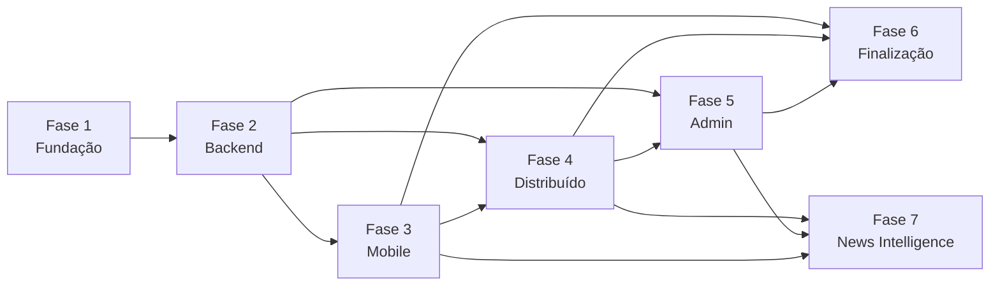

# 5. Roadmap com dependências

| Fase | Entregas | Depende de | Critério de conclusão (verificável) |
|---|---|---|---|
| **1 — Fundação** | Requisitos, arquitetura, design system (tokens + teste de contraste), monorepo, Docker Compose, schema + migration + seed, API mínima com health check | — | `npm run test:unit` e `npm run test:int` verdes; `GET /api/v1/health` = 200 com versão do PostGIS; `db:check-drift` sem diferenças |
| **2 — Backend** | Auth (cadastro, login, refresh, recuperação), usuários, ocorrências (CRUD + raio + filtros), fotos, confirmações, Swagger | 1 | Testes e2e de auth, RBAC, criação idempotente, upload e confirmação concorrente; Swagger completo |
| **3 — Mobile** | Projeto Flutter, tema a partir dos tokens, navegação, telas de auth, mapa, nova ocorrência, detalhes, meus registros, perfil | 2 (API real) | App em emulador Android autentica, registra ocorrência com GPS e foto, mapa lista dados da API; `flutter test` verde |
| **4 — Distribuído** | Outbox + publicador, Socket.IO autenticado, sincronização por cursor, Redis/BullMQ, worker, FCM, retries | 2, 3 | Cenário 2 emuladores: A registra → B vê sem atualizar; derrubar/religar Redis e API sem perda de eventos; push recebido |
| **5 — Administração** | Painel React: dashboard, moderação, mapa, relatórios + CSV, auditoria, usuários | 2, 4 | Moderar no painel reflete no app em tempo real; relatórios batem com consultas SQL; auditoria registra antes/depois |
| **6 — Finalização** | Testes de falha, revisão de segurança, refinamento visual, documentação APS, roteiro de demonstração | 3, 4, 5 | Critérios do enunciado oficial ([enunciado-aps.md](../academic/enunciado-aps.md)) verificados com evidência |
| **7 — News Intelligence** | Coleta de notícias (RSS/GDELT), regras, gazetteer IBGE, eventos, publicação e notificação de alertas, moderação, camada no mapa e tela de notícias | 3, 4, 5 | Etapas 1–12 de [07-news-intelligence.md](07-news-intelligence.md) com evidência em `docs/testing/fase-7.md` |

Fases 3 e 5 podem avançar em paralelo após a Fase 2, se houver mais de uma pessoa no grupo.
