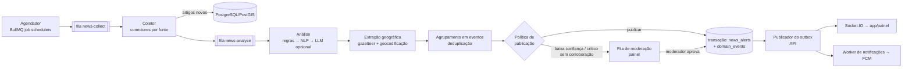
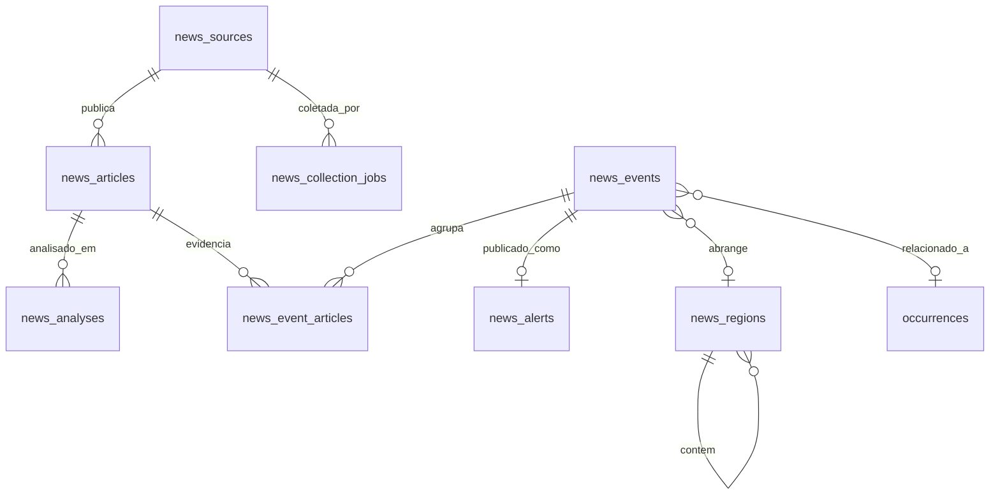

# 7. AlertaCidade News Intelligence — monitoramento de notícias

> Extensão do AlertaCidade 2.0 (Fase 7). Transforma notícias verificáveis em alertas
> georreferenciados **rastreáveis**, sem substituir os relatos dos cidadãos.
> Estado real de cada etapa: `docs/testing/fase-7.md`. **Este é o plano aprovado em 24/11/2026; onde a
> implementação diferiu, vale a seção 7.11.**

## 7.1 Diagnóstico da arquitetura existente

| Peça que já existe | Como o módulo de notícias reaproveita |
|---|---|
| **Outbox transacional** (`domain_events` + `OutboxPublisherService`, cursor `published_sequence`) | A decisão de publicar um alerta de notícia grava o evento `news.alert.*` **na mesma transação**. Nenhuma notificação sai antes de a decisão estar persistida (requisito 12). Tempo real e `/sync` passam a cobrir notícias sem código novo de entrega. |
| **Worker de notificações** (BullMQ, `processed_messages`, `UNIQUE(user_id, source_event_id)`, FCM, provedor de log) | Ganha um tratador para `news.alert.*`. A idempotência e o registro de tentativas (`push_status`, `push_attempts`) valem igualmente. |
| **Preferências por raio e gravidade mínima** (`notification_preferences`, PostGIS) | Destinatários de alerta de notícia = mesma área de interesse; para alertas regionais usa-se interseção área×área (`ST_DWithin` com o polígono da cidade). |
| **Moderação + auditoria** (`ModerationService`, `AuditService` na transação, controle otimista `version`) | Mesmo padrão para eventos de notícia: toda ação do moderador grava `audit_logs` na transação. |
| **Painel React** (`apps/admin`, perfis MODERATOR/ADMIN) | Nova página "Monitoramento de notícias". |
| **App Flutter** (mapa `flutter_map`, central de Alertas, `severity_widgets.dart`, tokens) | Nova camada no mapa e nova tela acessada **pela central de Alertas** (sem 5ª aba). |
| **Enum `Severity`** (LOW…CRITICAL, ordenado no Postgres) | Reutilizado. Para notícia a gravidade é **anulável**: ausência de evidência = "não informada", nunca "baixa". |

Lacunas encontradas: não existe agendador periódico (o outbox é *polling*, não *cron*); não existe gazetteer (cidades/bairros com geometria); o envelope de evento e o job da fila são tipados só para ocorrências (`OccurrenceEventPayload`). As três são tratadas abaixo.

## 7.2 Proposta de integração

Um **novo processo**, `apps/news-worker`, separado da API e do worker de notificações — se a coleta de um portal travar ou o analisador falhar, nada disso afeta o registro de ocorrências nem o envio de push.



- **Coleta, análise e notificação são filas diferentes**: cada uma tem retries com *backoff*, DLQ (jobs que esgotaram tentativas ficam em `failed` e em `news_collection_jobs`/`news_articles.processing_status = FAILED`) e pode ser reprocessada isoladamente.
- **Agendador**: `Queue.upsertJobScheduler` do BullMQ (um por fonte, intervalo vindo de `news_sources.collection_interval_sec`). Vários news-workers podem rodar: o scheduler é único no Redis.
- **Rate limiting por fonte**: intervalo mínimo entre requisições ao mesmo host + `limiter` do BullMQ; respeito a `Retry-After` e a HTTP 429.
- **Contrato de eventos**: `RealtimeEvent` ganha `news.alert.published`, `news.alert.updated`, `news.alert.retracted`, `news.alert.resolved`; o envelope passa a ser uma união discriminada por `type` (clientes antigos ignoram tipos desconhecidos — verificado na Etapa 10: o app antigo quebrava e foi corrigido). Eventos de moderação (`news.review.*`) são "só equipe" (7.11).

## 7.3 Fontes recomendadas

Nenhuma fonte será ligada sem conferir os termos de uso na data da ativação; o resultado fica registrado em `news_sources.terms_checked_at` e em `docs/testing/fase-7.md`.

| Fonte | Tipo | O que fornece | Uso automatizado | Papel |
|---|---|---|---|---|
| **GDELT DOC 2.0 API** | API aberta | URL, título, domínio, data, idioma, país | Aberta e gratuita, pensada para pesquisa | Descoberta ampla (Brasil, `sourcelang:por`) — sem resumo |
| **RSS de veículos** (ex.: G1 SP, Agência Brasil, portais regionais da Grande SP) | RSS | Título, link, data, resumo do próprio feed | Feeds são publicados para consumo automatizado; armazenar só o que o feed entrega | Fonte jornalística principal |
| **Google Notícias RSS (busca)** | RSS | Título, link, data, veículo | Termos restringem uso | **Não adotada** (decisão de 24/11) |
| **Defesa Civil (SP e municípios)** | Comunicados oficiais (RSS/página pública) | Avisos e alertas oficiais | Somente onde houver feed ou página pública sem bloqueio | Fonte **oficial** (eleva confiança) |
| **CGE São Paulo** (pontos de alagamento) | Página pública da prefeitura | Pontos ativos/transitáveis | Verificar termos e `robots.txt`; sem contornar bloqueios | Oficial, cidade de SP |
| APIs comerciais (NewsAPI, etc.) | API com chave | Título, resumo | Pagas ou restritas | **Não adotadas**: nada com custo (decisão de 24/11) |

> Fontes efetivamente configuradas e o resultado da conferência: `apps/news-worker/src/sources/catalog.ts` e `docs/testing/fase-7.md`. A camada 3 (modelo de linguagem) **não será usada** — tem custo; o sistema funciona só com as camadas 1 e 2.

**Nunca**: contornar paywall, login, captcha ou bloqueio; baixar o artigo completo. Armazenamos título, URL, datas, autor e **o resumo que a própria fonte publica no feed**, truncado em 500 caracteres.

## 7.4 Modelo de dados



| Tabela | Campos principais | Garantias |
|---|---|---|
| `news_sources` | `key` (único, ex. `gdelt`), `name`, `type` (`RSS`/`GDELT`/`OFFICIAL`/`API`), `reliability` (`OFFICIAL`/`ESTABLISHED_PRESS`/`AGGREGATOR`/`UNKNOWN`), `base_url`, `feed_url`, `enabled`, `collection_interval_sec`, `min_request_interval_ms`, `terms_checked_at`, `last_successful_collection_at`, `consecutive_failures` | `CHECK collection_interval_sec ≥ 300` (não martelar fontes) |
| `news_articles` | `source_id`, `title`, `url`, `canonical_url`, `url_hash` (SHA-256 da URL canônica), `title_fingerprint`, `published_at`, `collected_at`, `summary` (≤500), `author`, `language`, `external_id`, `processing_status`, `attempts`, `last_error`, `duplicate_of_id` | `UNIQUE(url_hash)` → recoleta não duplica; `UNIQUE(source_id, external_id)` |
| `news_analyses` | `article_id`, `rules_version`, `model_version` (nulo se só regras), `is_relevant`, `temporality` (`CURRENT`/`FORECAST`/`PREVENTION`/`HISTORICAL`/`RESOLVED`/`UNCERTAIN`), `estimated_severity` (anulável), `confidence`, `extracted_data` (JSON validado: locais, consequências, evidências textuais, informações ausentes), `reasoning_summary`, `analyzed_at` | `UNIQUE(article_id, rules_version, model_version)` → reprocessar com regra nova cria outra linha, a antiga fica para comparação |
| `news_regions` | gazetteer: `kind` (`STATE`/`METRO`/`CITY`/`DISTRICT`/`NEIGHBORHOOD`), `name`, `state` (UF), `ibge_code`, `parent_id`, `aliases[]`, `boundary geography(MultiPolygon)` — municípios pela malha do IBGE, metrópole = `ST_Union`, distritos **sem contorno** (o IBGE não fornece; GeoSampa pendente), `monitored` | `UNIQUE(kind, state, name)` |
| `news_events` | `event_type` (`FLOODING`/`RIVER_OVERFLOW`/`ROAD_BLOCKED`/…), `status` (ver 7.6), `title`, `region_id`, `city`, `state`, `place_text`, `location_precision` (`EXACT`/`STREET`/`NEIGHBORHOOD`/`CITY`/`REGION`/`UNKNOWN`), `latitude`/`longitude` **só se precisão ≤ STREET**, área = contorno IBGE da região calculado na consulta (7.11), `estimated_severity` (anulável), `confidence`, `independent_sources`, `event_occurred_at`, `first_evidence_at`, `last_evidence_at`, `related_occurrence_id`, `version`, `rules_version` | `CHECK` "ponto exige precisão ≤ STREET"; `CHECK` "publicado exige confiança ≠ LOW ou moderador" |
| `news_event_articles` | `event_id`, `article_id`, `is_independent`, `derived_from_article_id`, `similarity`, `linked_by` (`AUTO`/`MODERATOR`) | PK `(event_id, article_id)`; um artigo pertence a no máximo um evento ativo |
| `news_alerts` | `event_id` (único), `level` (`PRELIMINARY`/`VERIFIED`/`OFFICIAL`), `publication_status` (`ACTIVE`/`RETRACTED`/`RESOLVED`/`EXPIRED`), `notified_severity`, `revision`, `published_at`, `expires_at`, `reviewed_by_id`, `retraction_reason` | A notificação crítica só existe se `level ≠ PRELIMINARY` ou `reviewed_by_id` não nulo (verificado na política e por CHECK) |
| `news_collection_jobs` | `source_id`, `status` (`RUNNING`/`SUCCEEDED`/`FAILED`/`SKIPPED`), `trigger` (`SCHEDULE`/`MANUAL`/`RETRY`), `started_at`, `finished_at`, `items_found`, `items_new`, `http_status`, `error_message` | Métricas do painel e diagnóstico de falhas |

Vínculo com relatos colaborativos: `news_events.related_occurrence_id` é sugerido automaticamente quando há ocorrência `VALIDATED`/`PENDING` a ≤ 1 km e ≤ 6 h do evento (só com precisão ≤ NEIGHBORHOOD) e confirmado pelo moderador.

## 7.5 Pipeline de processamento

| Etapa | Entrada → saída | Falha |
|---|---|---|
| 1. Coleta | fonte → itens brutos | `news_collection_jobs.FAILED`, backoff progressivo por fonte (5, 15, 45 min… até 6 h), fonte não é desligada sozinha |
| 2. Normalização | item → `news_articles` (URL canônica, texto sem HTML, datas UTC, idioma) | item inválido é descartado com motivo no log estruturado |
| 3. Deduplicação de artigo | `url_hash` / `external_id` | `ON CONFLICT DO NOTHING` → idempotente |
| 4. Análise | artigo → `news_analyses` | 5 tentativas com backoff; depois `processing_status = FAILED` (DLQ), reprocessável pelo painel |
| 5. Extração geográfica | locais citados → região/ponto + precisão | ambíguo → `UNKNOWN` → moderação |
| 6. Classificação | evidências → gravidade + confiança | sem evidência → gravidade nula |
| 7. Agrupamento | artigo → evento novo ou existente | sob *advisory lock* por região (evita dois eventos iguais em paralelo) |
| 8. Validação/política | evento → status | regra documentada em 7.7, versionada em `rules_version` |
| 9. Publicação | transação `news_alerts` + `domain_events` | rollback total se qualquer parte falhar |
| 10. Notificação | worker existente | `processed_messages` + `UNIQUE(user_id, source_event_id)` |

### Estratégia híbrida de IA

1. **Regras determinísticas** (sempre): palavras-chave de alagamento, filtro de idioma/data, padrões de prevenção/previsão/histórico/resolvido, evidências de gravidade. Rodam sem rede e são 100% testáveis.
2. **NLP leve** (sempre): normalização de acentos, *tokens*, reconhecimento de topônimos pelo gazetteer (com desambiguação por UF e contexto), expressões temporais ("nesta segunda", "há 10 anos").
3. **Modelo de linguagem** (opcional, desligado por padrão): só para artigos que as regras marcam como ambíguos. Recebe título+resumo **delimitados como dado não confiável**, devolve JSON validado por esquema; cada afirmação precisa citar um trecho literal do texto (`evidence`), e trechos que não existirem no texto são descartados. Se o JSON for inválido, vale o resultado das regras. O modelo **nunca** cria coordenadas nem fatos — só classifica e extrai.

## 7.6 Estados

| Entidade | Estados | Observação |
|---|---|---|
| Artigo (`processing_status`) | `COLLECTED` → `ANALYZING` → `ANALYZED` \| `IRRELEVANT` \| `DUPLICATE` \| `FAILED` | Corresponde a COLETADO / EM_ANALISE / DESCARTADO |
| Evento (`status`) | `AWAITING_VALIDATION`, `PUBLISHED_PRELIMINARY`, `PUBLISHED_VERIFIED`, `DISCARDED`, `OUTDATED`, `RESOLVED` | AGUARDANDO_VALIDACAO / PUBLICADO_PRELIMINAR / PUBLICADO_VERIFICADO / DESCARTADO / DESATUALIZADO / RESOLVIDO |

`OUTDATED`: evento publicado sem evidência nova há mais de 6 h (configurável) sai do mapa como ativo, mas fica no histórico.

## 7.7 Regras de gravidade, confiança e publicação (versão inicial `rules-1`; vigente `rules-2`, ver 7.11)

**Gravidade = impacto relatado. Confiança = qualidade da evidência.** São campos separados.

### Gravidade (pela evidência mais forte encontrada no título+resumo)

| Nível | Evidências que contam | Não conta |
|---|---|---|
| CRITICAL | pessoas ilhadas; resgate; arrastado pela correnteza; morte/desaparecido; evacuação; desabrigados; calamidade/emergência decretada | adjetivos ("caos", "tragédia", "dilúvio", "apocalíptico") sem fato |
| HIGH | via interditada/bloqueada/fechada; intransitável; rio/córrego transbordou; casas/imóveis invadidos ou atingidos; desalojados | "pode transbordar", "risco de" |
| MODERATE | trânsito lento; via parcialmente alagada; transitável com dificuldade; faixa bloqueada | |
| LOW | acúmulo/bolsão de água; poças; transtorno pontual | |
| *(nula)* | nenhuma evidência de impacto | ausência ≠ baixo risco |

Negações e modalizadores anulam a evidência no mesmo trecho ("não houve feridos", "pode alagar").

### Temporalidade
`PREVENTION` (obras, piscinão, limpeza de bueiros, prevenir) · `FORECAST` (previsão, alerta de chuva, pode/deve, risco de) · `HISTORICAL` (relembra, há N anos, em AAAA passado; publicado há > 72 h) · `RESOLVED` (via liberada/reaberta, água baixou/escoou) · `CURRENT` (verbo de ocorrência + publicado ≤ 72 h) · `UNCERTAIN`.
Só `CURRENT` pode virar alerta ativo; `RESOLVED` encerra um evento existente.

### Confiança

| Nível | Critério (todos os itens) |
|---|---|
| HIGH | temporalidade `CURRENT`; localização ≥ `CITY` resolvida sem ambiguidade; e **(a)** fonte oficial atual, **ou (b)** ≥ 2 fontes **independentes** de imprensa estabelecida coerentes em local (mesma cidade) e tempo (≤ 6 h) |
| MEDIUM | `CURRENT`; localização ≥ `CITY`; ao menos 1 fonte de imprensa estabelecida; sem contradição |
| LOW | qualquer outro caso (fonte desconhecida/agregador sozinho, localização ambígua, temporalidade incerta, fontes contraditórias) |

**Independência**: domínios diferentes **e** textos não quase idênticos (similaridade de título < 0,9) **e** sem a mesma agência citada ("Agência Brasil", "Estadão Conteúdo", "com informações da…"). Republicação conta como a mesma fonte.

### Política de publicação

| Situação | Resultado |
|---|---|
| não relevante / prevenção / previsão / histórico | artigo `IRRELEVANT` (fica registrado com o motivo) |
| confiança LOW | `AWAITING_VALIDATION` — não aparece como ocorrência ativa |
| confiança MEDIUM | `PUBLISHED_PRELIMINARY` com selo "Notícia não confirmada"; push só se gravidade ≥ HIGH e não crítica |
| confiança HIGH | `PUBLISHED_VERIFIED` com lista de fontes; push conforme preferências |
| gravidade CRITICAL sem (fonte oficial atual **ou** ≥ 2 independentes **ou** aprovação de moderador) | publicação preliminar no mapa, **sem push**; entra na fila de moderação como urgente |
| fonte oficial | rótulo "Comunicado oficial" somente quando a fonte é `type = OFFICIAL`; notícia jornalística nunca é apresentada como alerta da Defesa Civil |
| correção/desmentido detectado ou moderador retrata | `news.alert.retracted` → app remove do mapa e quem foi notificado recebe aviso de correção |

## 7.8 Deduplicação e agrupamento

1. **URL canônica**: minúsculas no host, sem `www.`/`m.`/`amp`, sem `utm_*`, `fbclid`, `gclid`, fragmento e barra final → `url_hash`.
2. **Impressão do título**: sem acentos, sem *stopwords*, *tokens* ordenados.
3. **Mesmo evento** quando: cidade em comum **e** janela de ±6 h **e** sem conflito de local (se as duas citam distritos, ou as duas citam logradouros, ao menos um precisa coincidir). Se uma das matérias só cita a cidade, as duas descrevem o mesmo episódio de chuva ali e são agrupadas. Exemplo do enunciado: "Chuva alaga avenida em Osasco" e "Temporal causa interdição de via em Osasco" → mesma cidade e janela → mesmo evento, dois links. *(A similaridade de títulos foi descartada como critério de agrupamento: esses dois títulos têm Jaccard 0,13 — ela serve só para detectar republicação, ≥ 0,9.)*
4. **Escolha do evento** (quando há vários compatíveis): matéria com distrito → evento do mesmo distrito, senão evento só da cidade; matéria só com a cidade → evento só da cidade, ou o evento de distrito apenas se for o único candidato; com vários, abre evento próprio.
5. **Agrupar ≠ confirmar.** Para a confiança só contam fontes *elegíveis* — local sem ambiguidade e, em evento de distrito, que citem o distrito —, e cada grupo de mesma origem conta uma vez. As demais ficam no evento como contexto. (Regra criada após erros com notícias reais; ver `docs/testing/fase-7.md`.)
6. **Notificação única por evento**: o push é ligado ao `news_alerts.id`; nova fonte só gera novo push se a gravidade **subir** de nível ou o alerta passar de preliminar para verificado.

## 7.9 Wireframes

**Central de Alertas (entrada da nova tela, sem 5ª aba)**
```
┌──────────────────────────────────┐
│ Alertas                          │
│ ┌──────────────────────────────┐ │
│ │ 📰 Notícias e monitoramento  │ │
│ │ 3 alertas recentes na região ›│ │
│ └──────────────────────────────┘ │
│ [Todos][Não lidos][Críticos]...  │
│ • Alerta de alagamento — Osasco  │
└──────────────────────────────────┘
```

**Notícias e monitoramento**
```
┌──────────────────────────────────┐
│ ← Notícias sobre alagamentos     │
│ Informações recentes identificadas│
│ em fontes jornalísticas e        │
│ institucionais.                  │
│ [Cidade ▾][Período ▾][Gravidade ▾]│
│ [Fonte ▾][Verificação ▾]         │
│ ┌──────────────────────────────┐ │
│ │▌ALTO  ● Recente   Preliminar │ │
│ │ Chuva alaga avenida e        │ │
│ │ interdita via em Osasco      │ │
│ │ G1 · 24/11 14:20 · Osasco    │ │
│ │ Resumo curto do feed…        │ │
│ │ 2 fontes      Ver original ↗ │ │
│ └──────────────────────────────┘ │
└──────────────────────────────────┘
estados: carregando (esqueleto) · vazio ("Nenhuma notícia de
alagamento nas regiões monitoradas") · falha (tentar de novo) ·
sem internet (dados salvos + aviso)
```

**Mapa — resumo ao tocar num alerta de notícia**
```
┌──────────────────────────────────┐
│ 📰 Notícia · ALTO · Preliminar   │
│ Interdição por alagamento        │
│ Osasco (abrangência: cidade)     │
│ Ocorrido: 24/11 ~14h · Publ. 14:20│
│ Fonte: G1 (+1)                   │
│ [Ver notícia original] [Detalhes]│
│ Não é comunicado oficial.        │
└──────────────────────────────────┘
marcadores: pessoa = relato · jornal = notícia · brasão = oficial;
cor = gravidade (cinza tracejado = gravidade não informada);
alerta regional = polígono translúcido, sem pino.
```

**Painel — Monitoramento de notícias**
```
[Coletadas 412][Relevantes 37][Eventos 12][Publicados 6]
[Aguardando 4][Descartados 25][Falhas de coleta 1]
Gravidade: ▇▇ crítico ▇▇▇ alto ▇▇▇▇ moderado …   Fontes: 5 ativas
┌Título────────────┬Portal┬Cidade─┬Data──┬Grav.┬Conf.┬Status──┬Ações┐
│Chuva alaga av... │G1    │Osasco │14:20 │ALTO │MÉD. │Prelim. │ ⋯  │
```

## 7.10 Plano incremental

| Etapa | Entrega | Critério de conclusão |
|---|---|---|
| 1 | Este documento + escolha das fontes | aprovado pelo usuário; termos de cada fonte conferidos e anotados |
| 2 | Tabelas, enums, CHECKs, triggers e migration | `migrate deploy` + `db:check-drift` sem diferenças; testes de constraint |
| 3 | `apps/news-worker`: conectores RSS e GDELT (atrás de `NewsSourceAdapter`) | testes com feed de exemplo válido, inválido, HTTP 429/500, timeout |
| 4 | Filas de coleta/análise, agendador, DLQ, idempotência | teste de integração com Redis e Postgres reais; reprocessamento |
| 5 | Regras de relevância, temporalidade, gravidade e confiança | corpus simulado rotulado com métricas (precisão, falso alerta) |
| 6 | Gazetteer (malhas IBGE da Grande SP), extração geográfica, agrupamento | homônimos, notícia sem local, agrupamento do exemplo Osasco |
| 7 | API admin + página do painel | e2e de permissões e auditoria; Vitest das telas |
| 8 | Camada no mapa do app | teste de widget + emulador |
| 9 | Tela "Notícias e monitoramento" | testes de estados (carregando/vazio/falha/offline) |
| 10 | Notificações de notícia no worker | sem duplicidade, sem crítico não corroborado, fora da área não recebe |
| 11 | Testes de falha, precisão e segurança (prompt injection, SSRF nas URLs de fonte) | relatório em `fase-7.md` |
| 12 | Documentação técnica e acadêmica | README e roteiro atualizados |

**Ordem de execução adotada**: 1 → 5 (núcleo puro, testável sem rede) → 2 → 3 → 6 → 4 → 7 → 10 → 8 → 9 → 11 → 12. Começar pelas regras permite medir a qualidade da classificação antes de ligar qualquer fonte real.

## 7.11 Implementação — o que mudou em relação ao plano

Situação ao fim da Etapa 12 (24/11/2026). Evidências de cada item em `docs/testing/fase-7.md`.

| Plano | Implementado | Motivo |
|---|---|---|
| Regras `rules-1` | **`rules-2`**: municípios paulistas fora da área (IBGE), "X, em São Paulo" = estado, distritos homônimos exigem contexto, "região metropolitana de outra cidade" não é a Grande SP | Erros vistos com notícias reais (Etapas 5 e 11) |
| Camada 3 (modelo de linguagem, opcional) | **Não usada** | Decisão do usuário: nada com custo. O sistema funciona só com regras + NLP leve |
| Fontes: Google Notícias, APIs comerciais, CGE | Google e APIs pagas **não adotados**; CGE **não integrado** (sem feed); fontes ligadas: GDELT, Agência Brasil, g1 SP, Folha Cotidiano, CNN Brasil, Prefeitura de Osasco (`catalog.ts`) | Termos, custo e disponibilidade conferidos em 24/11 |
| `news_events.area` preenchida por trigger | **Sem coluna**: a área é o ponto (precisão ≤ rua) ou o contorno IBGE da região, calculado na consulta (`COALESCE(e.location, r.boundary, parent.boundary)`); distrito sem contorno usa o da cidade. O mesmo critério serve ao push, ao mapa e à busca por raio | Distritos não têm contorno no IBGE; evita duplicar geometria e mantém um só critério |
| `event_type` com `ROAD_BLOCKED` | `FLOODING`, `RIVER_OVERFLOW`, `FLASH_FLOOD` | Interdição é consequência (vira gravidade/"consequência relatada"), não tipo de evento |
| Agrupamento por similaridade de título | Por cidade + janela de ±6 h + conflito de local; similaridade só detecta republicação; "agrupar ≠ confirmar" (7.8) | Títulos do mesmo episódio têm Jaccard baixo (0,13 no exemplo do enunciado) |
| Vínculo automático com relato de cidadão (≤ 1 km, ≤ 6 h) | **Não implementado**: o campo `related_occurrence_id` existe e o painel o exibe, mas nada o sugere | Pendência |
| Moderação | Mantida para confiança baixa e para liberar push crítico de fonte única (decisão de 24/11), com **aviso imediato à equipe**: `news.review.urgent` no outbox quando o evento passa a ser urgente → push e caixa para MODERATOR/ADMIN + faixa "Revisão urgente" no painel em tempo real | Reduzir a demora sem automatizar o que é arriscado |
| Eventos de domínio para todos os clientes | Eventos **"só equipe"** (`news.review.*`): Socket.IO só nas salas `role:MODERATOR`/`role:ADMIN`; `GET /sync` os omite para cidadãos (o cursor avança) | O aviso traz título de notícia ainda não publicada |
| Rotas públicas | `GET /news/events` (mapa e lista; `scope=active` só em vigor e não vencido, `scope=all` histórico; retirado nunca), `GET /news/events/:id` (abre retirado, com motivo), `GET /news/regions/:id/boundary` (GeoJSON simplificado), `GET /news/filters` | Etapas 8–9 |
| App | Camada no mapa (quadrado com jornal/prédio público; área translúcida para alerta regional, cinza tracejado sem gravidade), resumo e detalhes; tela "Notícias e monitoramento" pela central de Alertas, com filtros e dados salvos para uso sem internet; push abre a notícia (ou a central, no aviso de moderação) | Etapas 8–9 |
| Segurança das coletas | Além do plano: checagem de IP **na conexão** (DNS rebinding) e parser IPv6 completo — `[::ffff:127.0.0.1]` passava pelo filtro original | Etapa 11 |
| Avaliação | Corpus simulado (desenvolvimento) + **280 notícias reais** rotuladas (teste): precisão 88,9 %, recall 100 %, 0 push indevido antes do ajuste; ferramentas `snapshot-feeds` e `eval-real` | Etapa 11 |

